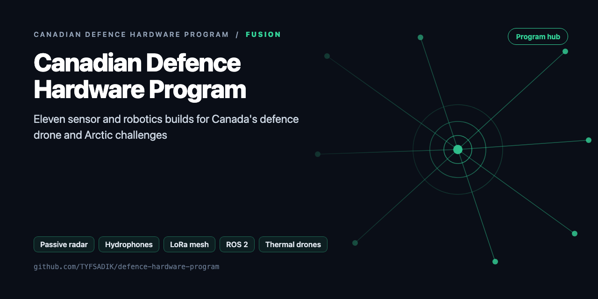
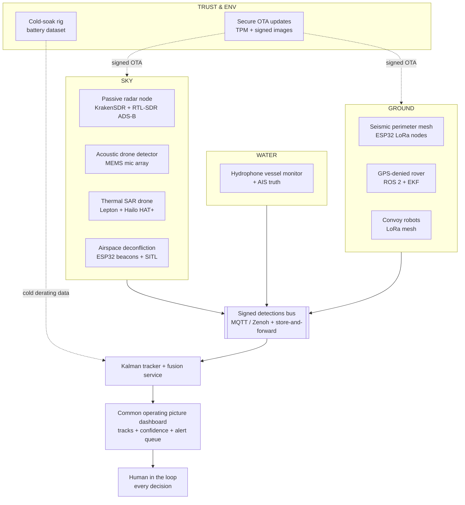

<div align="center">



# Canadian Defence Hardware Program

**23 open-source sensor, robotics and security builds, each one built against a real, published Canadian defence requirement.**

  [](LICENSE) [](https://github.com/TYFSADIK/defence-hardware-program)

[The builds](#the-builds) · [Architecture](#program-architecture) · [Status](#status) · [Get started](#get-started)

</div>

## Why this exists

In 2026 Canada started saying, in public documents, exactly what it wants built. I read those documents as free requirements specs and started building against them in my own lab:

- **Defence Drone Initiative (DDI)**, launched July 23, 2026. First priority areas: low-cost tactical ISR drones, and ground robots for resupply, casualty evacuation, and terrain too hazardous for personnel.
- **Army MINERVA challenges**, the Army states it has bought foreign robotic systems of mixed quality, with problems in cold-weather operation and components from unstable supply chains, and that it currently lacks a drone that can do ISR in Arctic conditions. The Arctic drone call closed September 24, 2026; the full text reads like an evaluator's checklist.
- **DRDC field trials**, GPS-denied navigation, convoying, cold-weather performance, and resilient operation, exercised on events like Operation NANOOK.
- **NRC + DRDC counter-drone work**, a detection system that picks up the signature of a drone's rotating propellers without emitting any radio signal that could reveal its own location.
- **Airspace deconfliction**, the Army is studying how to manage airspace shared by many uncrewed aircraft at once.

These calls are aimed at companies, not students, so I treat them as requirements documents, not application forms. Every build below answers one of them at hobby scale, with real hardware, honestly reported measurements, and published datasets or dashboards landing as each build matures, see each page's status section for what is done, in progress, or still a target.

## Program architecture



*Every node is receive-only or self-contained, signs its output, and feeds one fused picture with a human deciding.*

## The builds

### Sky

Air sensing, drones and counter-drone.

| Build | What it does | Stage | Built with |
|---|---|---|---|
| [**Sky: Passive Aerial Early-Warning Node**](https://github.com/TYFSADIK/sky-passive-radar-node) | Receive-only passive radar that sees aircraft by their broadcast reflections |  | Python (NumPy DSP) |
| [**Passive Acoustic Drone Detector**](https://github.com/TYFSADIK/acoustic-drone-detector) | A microphone array that hears drone rotors and points to where they are |  | Python |
| [**Counter-Drone Sensor Fusion Simulator**](https://github.com/TYFSADIK/counter-drone-sensor-fusion) | Simulated radar, RF, acoustic and camera tracks fused into one triaged picture |  | Python |
| [**Counter-Drone Test-and-Scoring Harness with Sensor-Fleet Operations**](https://github.com/TYFSADIK/counter-drone-scoring-harness) | Scenario cards and honest metrics for scoring counter-drone sensors |  | Python |
| [**Mini Airspace Deconfliction Manager**](https://github.com/TYFSADIK/airspace-deconfliction-manager) | Who is flying where: geofences, conflict prediction and human override |  | Python |
| [**Thermal Search-and-Rescue Drone**](https://github.com/TYFSADIK/thermal-sar-drone) | A thermal drone that finds people in snow and brush with on-board AI |  | Python |
| [**Arctic ISR Drone (Cold, Glove-Operable, Thermal, TAK)**](https://github.com/TYFSADIK/arctic-isr-drone) | A cold-weather thermal drone with glove controls and TAK markers |  | Python |
| [**Operation LENTUS-Style Disaster Response Drone Mapping**](https://github.com/TYFSADIK/lentus-drone-mapping) | Simulated drone flights that map floods and wildfires for responders |  | Python |

### Water

Maritime sensing and survey.

| Build | What it does | Stage | Built with |
|---|---|---|---|
| [**Water: Passive Acoustic Vessel Monitor**](https://github.com/TYFSADIK/water-passive-acoustic-vessel-monitor) | A dock hydrophone that identifies passing boats by their sound |  | Python |
| [**Autonomous Boat for Seabed Surveys and Anomaly Detection**](https://github.com/TYFSADIK/seabed-survey-boat) | An autonomous boat that maps the seabed and flags anomalies |  | Python |

### Ground

Ground sensors, rovers and cold-weather data.

| Build | What it does | Stage | Built with |
|---|---|---|---|
| [**Ground: Seismic & Acoustic Perimeter Mesh**](https://github.com/TYFSADIK/ground-seismic-perimeter-mesh) | Solar LoRa sensor nodes that tell vehicles from footsteps |  | C++ (ESP32) + Python |
| [**GPS-Denied Navigation Rover**](https://github.com/TYFSADIK/gps-denied-navigation-rover) | A ROS 2 rover that keeps navigating after GPS is cut |  | C++ (ROS 2) + Python |
| [**Convoy-Following Robots on a Degraded Mesh**](https://github.com/TYFSADIK/rover-drive-stack) | Convoy robots that hold formation through radio link drops |  | C++ (ESP32) |
| [**GPS-Denied Cargo Ground Vehicle for Snow**](https://github.com/TYFSADIK/gps-denied-cargo-ugv) | A cargo rover for snow that navigates without GPS |  | Python |
| [**Cold-Soak Battery Characterization Rig**](https://github.com/TYFSADIK/cold-soak-battery-rig) | How drone batteries really behave in a Canadian winter, measured |  | Python + C++ (ESP32) |

### Fusion

Bringing every sensor into one picture.

| Build | What it does | Stage | Built with |
|---|---|---|---|
| [**Multi-Domain Common Operating Picture**](https://github.com/TYFSADIK/multi-domain-common-operating-picture) | One live picture fusing every air, water and ground sensor |  | Python |
| [**Arctic Domain Awareness Digital Twin**](https://github.com/TYFSADIK/arctic-domain-awareness) | A digital twin of Canada's North that flags dark vessels |  | Python |

### Trust

Security, accountability and how code reaches the fleet.

| Build | What it does | Stage | Built with |
|---|---|---|---|
| [**Decision Black Box**](https://github.com/TYFSADIK/decision-black-box) | A tamper-evident flight recorder for human decisions |  | Go |
| [**Secure Robot-Fleet Updates**](https://github.com/TYFSADIK/secure-fleet-updates) | Signed over-the-air updates with automatic rollback for robots |  | Go |
| [**Secure Autonomy for the Robot and Drone Fleet**](https://github.com/TYFSADIK/secure-fleet-autonomy) | Hardening a robot and drone fleet against spoofing and tampering |  | Python |
| [**DDIL-Proof DevOps**](https://github.com/TYFSADIK/ddil-proof-devops) | CI/CD that keeps shipping over denied and broken networks |  | Go |
| [**Zero-Trust Air-Gapped Software Supply Chain**](https://github.com/TYFSADIK/zero-trust-air-gapped-supply-chain) | Signed, reproducible software carried across an air gap |  | Go |
| [**Sovereign AI and Data Enclave**](https://github.com/TYFSADIK/sovereign-ai-enclave) | A private AI enclave where every answer respects clearance labels |  | Python |

**Stages:** *Built* is finished hardware. *In progress* is hardware on the bench with code running. *Simulation* is a software build that runs entirely on simulated or open data. *Planned 2027* is a published build guide with working simulation code, written against a real spec before the hardware is bought.

## Status

- **Did**: bought and benched the full workshop (Phase 0) and the Phase 1-6 hardware; ADS-B receiver live with a real-time aircraft map; ROS 2 + Gazebo + ArduPilot SITL simulation environment running on the homelab cluster; first cold-soak freezer runs logged.
- **Doing**: KrakenSDR passive-radar processing chain (range-Doppler plots scored against ADS-B); rover EKF tuning with GNSS-cut drift tests; hydrophone + AIS capture rig; ESP32 LoRa mesh firmware; thermal detection pipeline on the Hailo HAT+.
- **Next**: publish the cold-soak dataset (runtime, voltage sag, failure mode vs temperature); multi-node passive-radar fusion; signed OTA rollout across the rover fleet with cold-chamber rollback tests; the multi-domain common operating picture tying every node together with chaos tests.

Designed means the protocol is written, built means the hardware is running, measured means results are published.

| Phase | Designed | Built | Measured |
|----|----|----|----|
| Phase 0: Workshop and shared infrastructure | Yes | Yes (benched) | Not applicable |
| Phase 1: Sky node (passive radar + ADS-B truth) | Yes | ADS-B receiver live with real-time aircraft map; KrakenSDR processing chain in progress | ADS-B map operational; no radar scoring published yet |
| Phase 2: Water node (hydrophone + AIS) | Yes | In progress (capture rig) | No measurements published yet |
| Phase 3: Ground mesh and deconfliction beacons | Yes | In progress (ESP32 LoRa mesh firmware) | No measurements published yet |
| Phase 4: Rovers (GPS-denied navigation + convoy) | Yes | In progress (ROS 2 + Gazebo + ArduPilot SITL environment running; EKF tuning) | No published drift figures yet |
| Phase 5: Drone (thermal SAR + acoustic detector) | Yes | In progress (thermal detection pipeline on Hailo HAT+) | No measurements published yet |
| Phase 6: Cold-soak rig + secure fleet updates | Yes | Rig built; first freezer runs logged; secure updates in progress | Initial runs logged; dataset not yet published |
| Multi-domain COP | Yes | In progress (dashboard live on homelab cluster, seismic mesh feeding it) | Chaos-test metrics pending |

## Get started

Every build is its own repo with a demo that runs on simulated data, so you can try any of them without hardware:

```bash
git clone https://github.com/TYFSADIK/acoustic-drone-detector
cd acoustic-drone-detector && pip install -r requirements.txt && python demo.py
```

To work on the whole program, clone the repos side by side and set up the shared toolchain once:

```bash
./scripts/setup-dev.sh                # Go, Python, OPA, cosign, syft, mosquitto, PlatformIO
python -m program.status .. --md      # test status of every build
```

| In this repo | Purpose |
|---|---|
| [`INTEGRATION.md`](INTEGRATION.md) | How all the builds connect physically and logically, and the order to build them in |
| [`interfaces/detection.schema.json`](interfaces/detection.schema.json) | The signed detection message every sensor publishes |
| [`program/status.py`](program/status.py) | Runs every build's tests and reports the results |
| [`docs/project-page.md`](docs/project-page.md) | The full program write-up: requirement sources, roadmap, bills of materials by phase, workshop safety |

## Ground rules

- **Receive-only and defensive.** Sensors listen; nothing jams, spoofs or interferes with anyone else's systems.
- **Honest numbers.** Results are published only when there is a real run series behind them. Targets are labelled as targets.
- **Open data and my own hardware only.** Simulations use fictional scenarios and public data sources.

## License

[MIT](LICENSE). Designed, built and documented by [Taki Sadik](https://tyfsadik.org).
